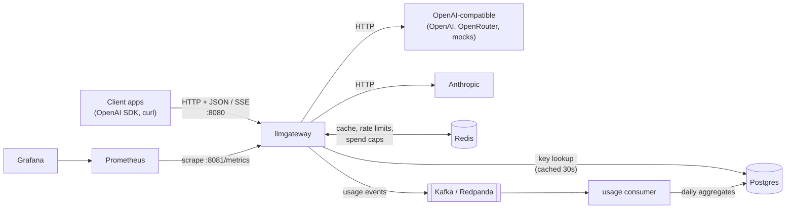
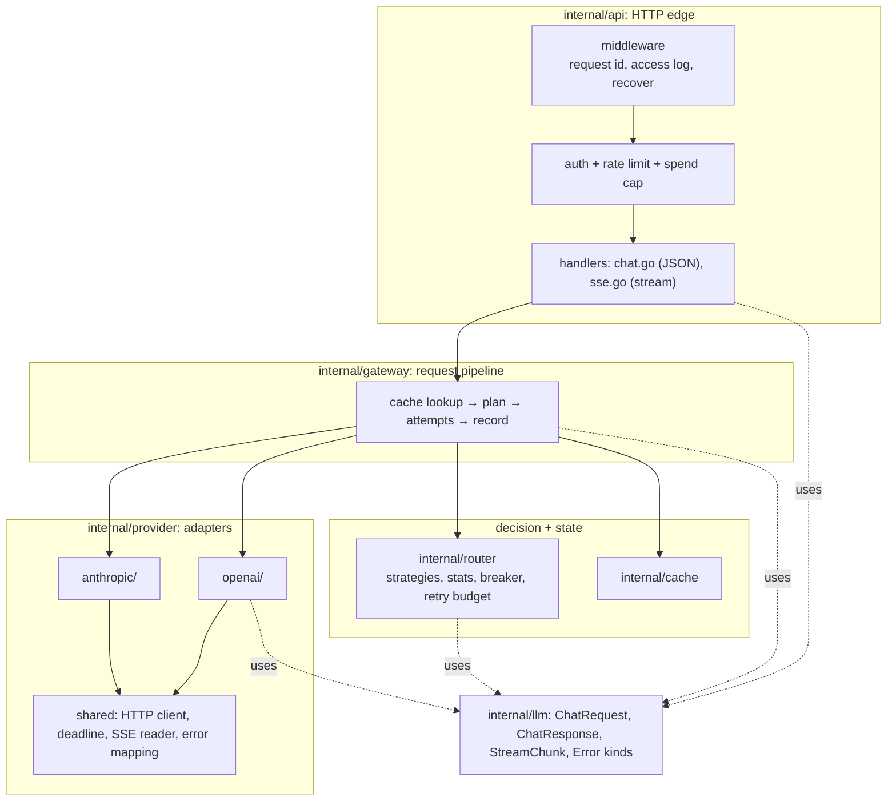
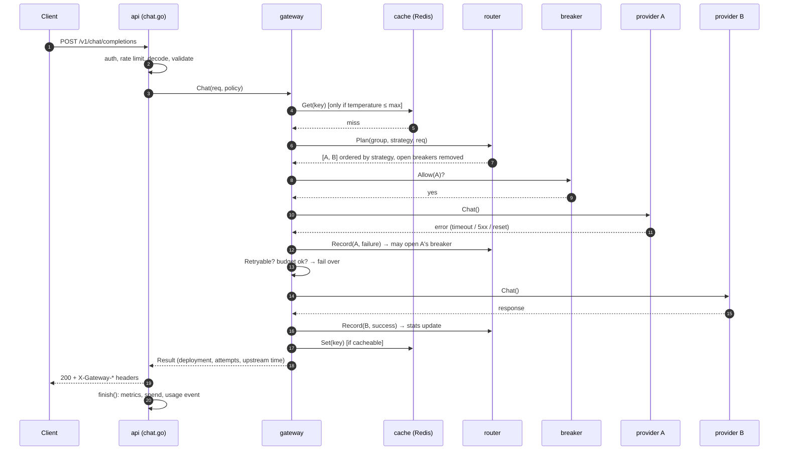
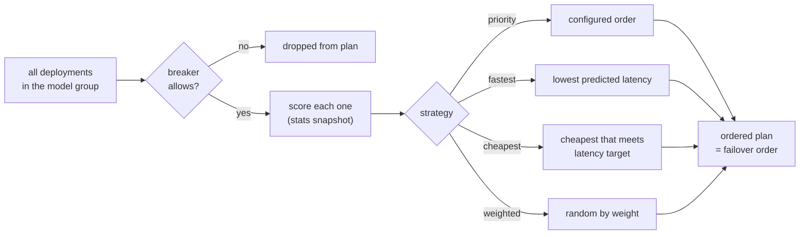
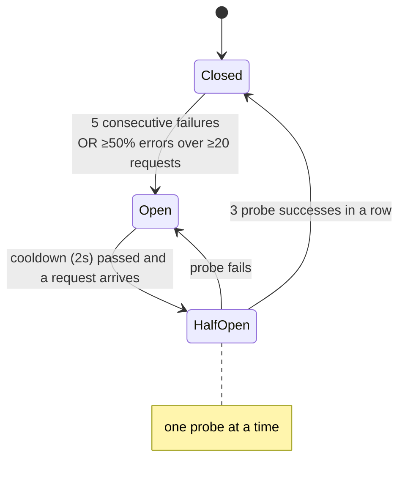
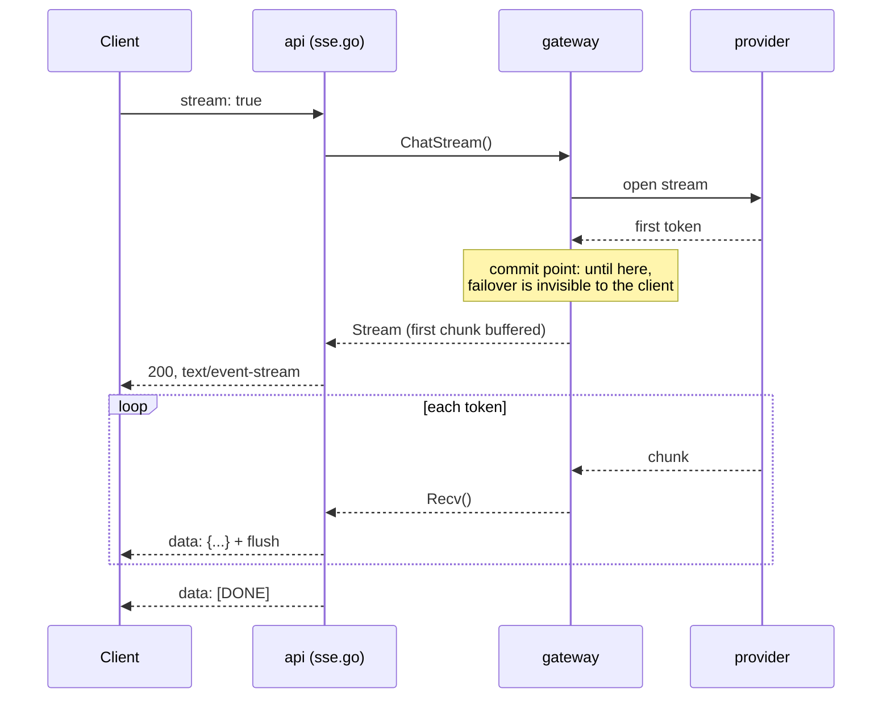
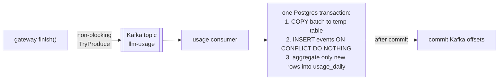

# Architecture

How the pieces fit together. For *why* each choice was made, see
[DECISIONS.md](../DECISIONS.md); the `D<n>` references below point there.

## 1. The system at a glance

Apps send OpenAI-format requests to one endpoint. The gateway authenticates,
checks limits, tries the cache, picks a provider from live health and price
data, fails over when one breaks, and records usage and metrics.

Every box except the gateway and the providers is **optional**: leave its config
section out and the feature is off (D32). `make run` needs none of them.

## 2. Inside the gateway: layers

Each layer only calls the one below it. `llm` is the shared vocabulary and
imports nothing, which keeps the dependency graph free of cycles (D1).

| Layer | Knows about HTTP? | Knows about providers? | Makes network calls? |
|---|---|---|---|
| api | yes (client side) | no | no |
| gateway | no | through the interface only | indirectly |
| router | no | no | **never**: pure decisions on in-memory state |
| provider | yes (upstream side) | yes, one each | yes |

## 3. One request, step by step (non-streaming)

| Step | File, function |
|---|---|
| 1–2 | `internal/api/auth.go` `withAuth`, `internal/api/chat.go` `handleChat` |
| 3–5 | `internal/gateway/gateway.go` `Chat` |
| 6–7 | `internal/router/router.go` `Plan` |
| 8–17 | `internal/gateway/gateway.go` `chatUpstream`, `recordAttempt` |
| 10, 15 | `internal/provider/openai/openai.go` `Chat`, `internal/provider/http.go` `Do` |
| 20 | `internal/api/chat.go` `finish` |

**Hedging** (optional, per model group, D26): if attempt A hasn't answered after
`hedge_after`, attempt B starts in parallel. The first success wins; the loser
is cancelled and recorded as neutral.

## 4. Choosing a provider: the router

**Sticky routing** (D34): with `X-Gateway-Session: <id>`, the deployment that
served the conversation's last turn is moved to the front of the plan, so
multi-turn chats keep the provider's prompt cache. It never overrides health:
an open breaker removes the deployment from the plan first.

**Predicted latency** = base latency p95 + expected output tokens × time per
token, divided by (1 − error rate) (D22). Strategy comes from, in priority
order: the `X-Gateway-Strategy` header, then the API key's default, then the
model group's default.

## 5. Circuit breaker states

One breaker per (model group, deployment) (D24).

Only failures that are the provider's fault count (timeouts, 5xx, 429,
connection errors). Bad requests and client disconnects don't (D4).

**Retry budget** (D25): failovers and hedges together are capped at about 20%
of traffic. Failing over *away from an open breaker* is free, which is why a
single dead provider causes no errors.

## 6. Streaming

| Situation | Behaviour |
|---|---|
| Provider fails **before** the first token | Silent failover to the next provider (D16) |
| Provider fails **after** the first token | `data: {"error":...}`, stream ends without `[DONE]` (D17) |
| Client disconnects | Upstream request is cancelled, so no more tokens are billed |
| Provider goes silent | "No progress" deadline fires, which counts as a timeout (D15) |

## 7. Usage pipeline: at-least-once in, exactly-once effect out

A crash anywhere means the batch is redelivered, and duplicate event IDs are
ignored, so totals stay correct (D30). Verified by replaying the topic from
offset 0.

## 8. What happens when a dependency is down

| Down | Effect | Why |
|---|---|---|
| One provider | Traffic moves to the others; breaker opens | core feature (D24) |
| All providers in a group | Fast 503 `no_healthy_upstream` | waiting on known-dead providers helps nobody |
| Redis | Cache skipped, limits not enforced (fail open), 5s backoff | availability over strictness (D27, D28) |
| Postgres | Cached keys keep working; new keys get 503 | (D29) |
| Kafka | Events buffered in memory, then dropped and counted when the buffer is full | billing data must not block serving (D30) |
| Usage consumer | Kafka holds the backlog; nothing lost | separate binary (D30) |

## 9. Ports and binaries

| Binary | Port | Purpose |
|---|---|---|
| `cmd/gateway` | :8080 | public API |
| | :8081 | `/metrics`, `/admin/deployments`, `/debug/pprof` (internal only) |
| `cmd/mockprovider` | :9001–9003 | fake providers, `PATCH /admin/behavior` |
| `cmd/usageconsumer` | — | Kafka → Postgres |
| `cmd/keyctl` | — | create / list / revoke API keys |

## 10. Known limits

- A **hung** provider can't be detected faster than its timeout: the first
  requests each wait the full timeout (measured: about 2s at p99 with a 2s timeout).
- Spend caps are soft: in-flight requests can overshoot (D28).
- Usage events still in memory are lost on SIGKILL (D30).
- Text only: tools, images and `n > 1` are rejected with 400.
- Config is read once at startup; changes need a restart.
