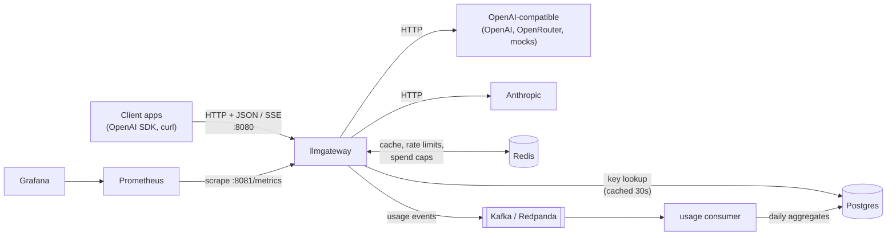
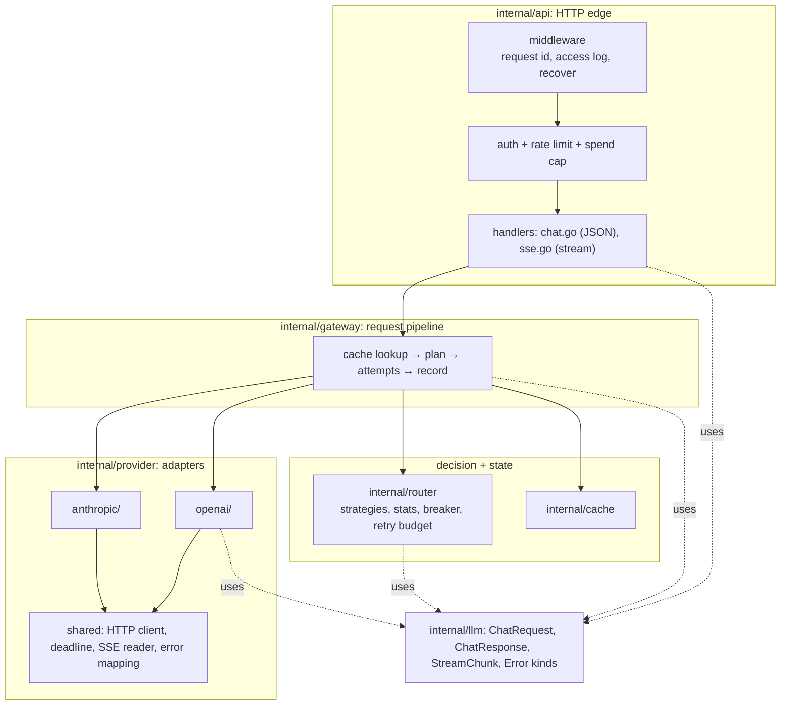
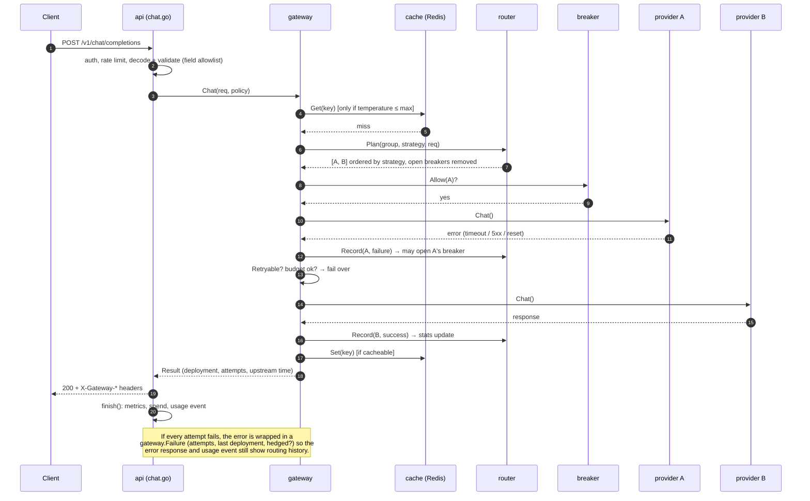
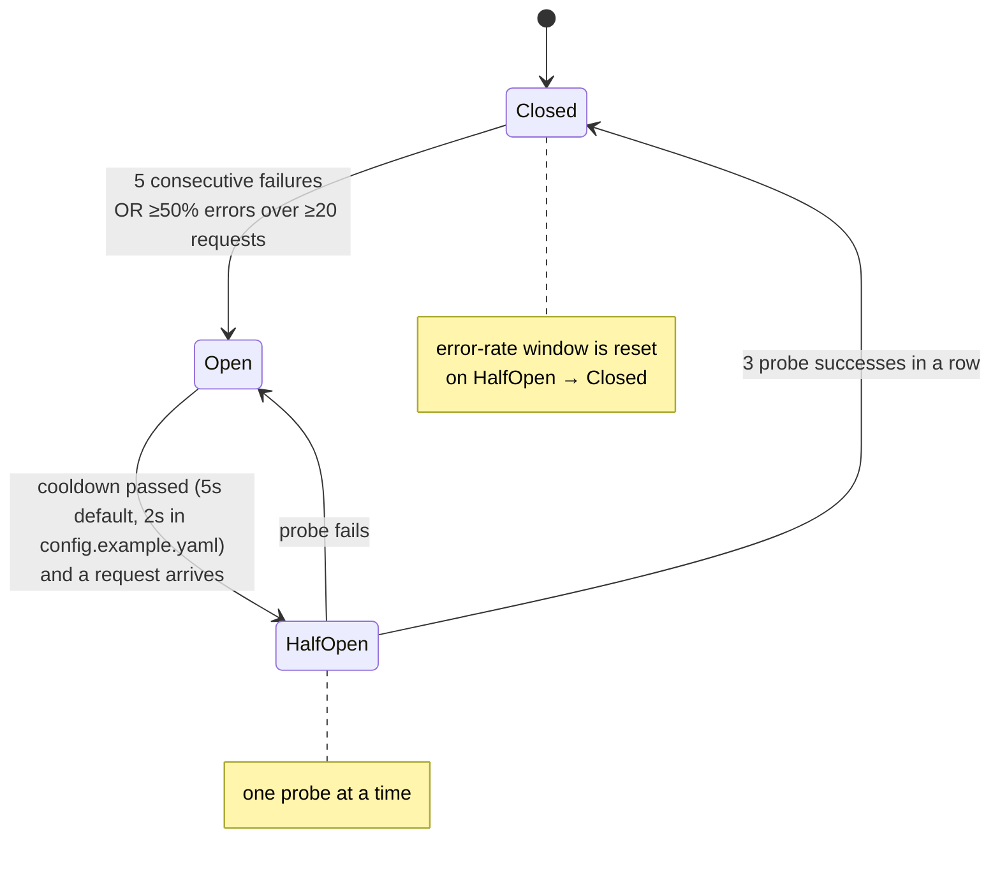

# Architecture

How the pieces fit together. The main design choices are summarized in the
[README](../README.md#design-choices).

## 1. The system at a glance

Apps send OpenAI-format requests to one endpoint. The gateway authenticates,
checks limits, tries the cache, picks a provider from live health and price
data, fails over when one breaks, and records usage and metrics.

Every box except the gateway and the providers is optional: leave its config
section out and the feature is off.

## 2. Inside the gateway: layers

Each layer only calls the one below it; `llm` is the shared vocabulary and
imports nothing, keeping the dependency graph free of cycles.

| Layer | Knows about HTTP? | Knows about providers? | Makes network calls? |
|---|---|---|---|
| api | yes (client side) | no | no |
| gateway | no | through the interface only | indirectly |
| router | no | no | never: pure decisions on in-memory state |
| provider | yes (upstream side) | yes, one each | yes |

## 3. One request, step by step (non-streaming)

Hedging (optional per group): if attempt A hasn't answered after
`hedge_after`, attempt B starts in parallel; the loser is cancelled and
recorded as neutral.

## 4. Choosing a provider: the router

Strategies rank deployments whose breaker allows traffic: `priority` uses
configured order, `fastest` picks lowest predicted latency, `cheapest`
picks cheapest meeting `X-Gateway-Latency-Target-Ms`, `weighted` splits
randomly. Predicted latency = base latency p95 + expected tokens × time per
token, divided by (1 − error rate).

Sticky routing: with `X-Gateway-Session: <id>`, the deployment that
served the conversation's last turn moves to the front of the plan, unless
its breaker is open.

## 5. Circuit breaker states

One breaker per (model group, deployment).

Only failures that are the provider's fault count toward the breaker
(`CountsAsFailure()`): Timeout, Unavailable, RateLimited, Auth, Unknown.
BadRequest, ContentFilter, Canceled and NotFound never count. Retry budget:
failovers and hedges together are capped at about 20% of traffic;
failing over away from an already-open breaker is free.

## 6. Streaming

Commit point: the gateway reads the first real chunk from upstream before
the API layer writes response headers, so failover before the first token
is invisible to the client. After the first token, a failure ends the
stream with an SSE `{"error":...}` event and no `[DONE]`. A client
disconnect cancels the upstream request; a silent provider trips the
"no progress" deadline, counted as a timeout.

## 7. Usage pipeline

`gateway finish()` does a non-blocking produce to a Kafka topic; the usage
consumer aggregates each batch into Postgres in one transaction (insert
new rows, aggregate, commit, then commit Kafka offsets), so a crash just
causes a harmless redelivery. Verified by replaying the topic from
offset 0.

## 8. What happens when a dependency is down

| Down | Effect |
|---|---|
| One provider | Traffic moves to the others; breaker opens |
| All providers in a group | Fast 503 `no_healthy_upstream` |
| Redis | Cache skipped, limits fail open, 5s backoff |
| Postgres | Cached keys keep working; uncached keys fail fast for 5s as 503, never 401 |
| Kafka | Events buffered, then dropped and counted if full |
| Usage consumer | Kafka holds the backlog; nothing lost |

## 9. Ports and binaries

| Binary | Port | Purpose |
|---|---|---|
| `cmd/gateway` | :8080 | public API |
| | :8081 | `/metrics`, `/admin/deployments`, `/debug/pprof` (internal only) |
| `cmd/mockprovider` | :9001–9003 | fake providers, `PATCH /admin/behavior` |
| `cmd/usageconsumer` | none | Kafka → Postgres |
| `cmd/keyctl` | none | create / list / revoke API keys |

Error responses carry the same routing headers as success responses when
something was tried (`X-Gateway-Attempts`, `-Provider`, `-Hedged`); a
request that failed before any attempt carries none of these.

## 10. Known limits

- A hung provider can't be detected faster than its timeout (measured: about 2s at p99 with a 2s timeout).
- Spend caps are soft: in-flight requests can overshoot.
- Usage events still in memory are lost on SIGKILL.
- Text only: tools, images and `n > 1` are rejected with 400.
- Config is read once at startup; changes need a restart.
- The monthly spend cap's window uses the gateway's local clock, and the check and the charge can run minutes apart, so a request spanning a UTC month boundary is billed to the wrong month. At most one request per boundary; accepted since the cap is already soft.
